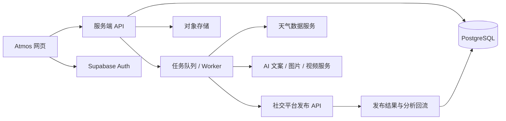

# 后端接入建议

当前版本先验证视觉和创作流程。建议下一阶段用 **Supabase + 服务端 API + 异步任务队列**，按真实使用顺序接入，不一次性覆盖所有平台。

## 建议架构

这是针对该产品的架构建议，不表示当前项目已经连接这些服务。

## 服务分工

| 模块 | 推荐实现 | 原因与边界 |
| --- | --- | --- |
| 账户与数据 | Supabase Auth + PostgreSQL | 统一账户、工作区、草稿与版本；利用 RLS 按工作区限制读取。Supabase 的关系数据库适合主题、项目、素材和排期之间的关联。 |
| 图片与视频 | 先用 Supabase Storage；视频规模增长后评估专用媒体服务 | 数据库保存素材元信息与地址，文件放对象存储；生成文件通过带有效期的地址下载。 |
| 天气 | Open-Meteo 做早期评估；中国市场另评估本地供应商 | 先接入地理位置、预报与天气类型，15–30 分钟缓存。商用接入前选相应商业许可，并保留天气数据来源及更新时间。 |
| 热点与社交热度 | 单独的数据采集与评分服务 | 天气 API 不提供“社交提及量”“传播潜力”或全平台热度。应明确授权数据源、覆盖范围、更新时间和算法口径。初期可以采用编辑精选热点。 |
| AI 生成 | 服务端封装模型供应商适配器 | 文案先落地；图片和视频采用异步任务，记录排队、运行、成功、失败状态、成本及重试。客户端不保存供应商密钥。 |
| 发布排期 | 服务端持久化任务 + Worker | 保存 UTC 时间以及用户时区，后台领取到期任务；平台 OAuth、刷新令牌、幂等键、重试及失败反馈都在服务端处理。 |
| Analytics | 先统计已连接账号自己的内容 | 与第三方平台返回的可用指标对应，标明时间范围、延迟与最后同步时间。不要把示例热点指标当成真实统计。 |

以上能力依据 [Supabase 数据库文档](https://supabase.com/docs/guides/database/overview)、[Supabase Storage 文档](https://supabase.com/docs/guides/storage)及 [Open-Meteo 文档](https://open-meteo.com/en/docs)评估。Open-Meteo 的免费接口适合非商业评估；商业用途应按其[商业许可说明](https://open-meteo.com/en/pricing)选择对应方案，不在此估算价格。

## 建议的数据表

| 表 | 主要字段 |
| --- | --- |
| `workspaces` / `workspace_members` | 名称、所有者、成员、角色 |
| `brand_kits` | 工作区、品牌名、色彩、语气、禁用词 |
| `weather_topics` | 地区、经纬度、天气类型、标题、来源、观测时间、趋势评分 |
| `projects` | 工作区、主题、简报 JSON、状态、更新时间 |
| `script_versions` | 项目、内容格式、场景 JSON、模型、版本 |
| `assets` | 项目、存储路径、MIME 类型、宽高、生成任务、版权来源 |
| `generation_jobs` | 任务种类、状态、输入／输出、错误、重试次数、成本 |
| `social_connections` | 工作区、平台、账号 ID、加密令牌引用、到期时间 |
| `scheduled_posts` | 项目、目标平台、文案、素材、UTC 发布时间、时区、状态、幂等键 |
| `post_metrics_daily` | 平台发布 ID、日期、曝光、互动、点击、数据来源 |

## 分阶段接入

1. **账户与云端草稿**：登录、工作区、品牌设置、项目版本、素材上传及浏览器草稿迁移。
2. **真实天气与文案生成**：先支持少量国家和精选城市；天气缓存、来源展示、文案生成任务及人工编辑。
3. **图片生成与图文导出**：保存提示词、生成历史、比例与素材版本；支持可复现的导出结果。
4. **单平台发布**：先确认最重要的平台，完成授权、测试账号、排期、结果回流，再扩展其他平台。
5. **视频及分析**：渲染、异步进度、真实账号指标、效果归因。

TikTok 直发需要应用审批、用户授权及相应权限；未审核客户端的发布可见性有限制，不能承诺注册一个 API Key 就可公开发布。见 [TikTok Content Posting API 官方接入说明](https://developers.tiktok.com/docs/en/content-posting-api-get-started)。其他平台的具体可用能力应在选定平台后逐一确认。

## 下一阶段需要确定

- 面向个人创作者还是团队／多品牌？是否需要多人审批？
- 首批服务中国还是海外用户，重点国家／城市是什么？
- 首个真实发布平台和账号类型是什么？
- 优先落地文案、图片还是视频？每月大致生成量和预算如何？

这些选择会影响数据源、部署区域、任务成本和平台接入顺序。当前原型保留统一的状态与页面入口，后续可将本地模板、素材及 localStorage 替换为服务端 API。
