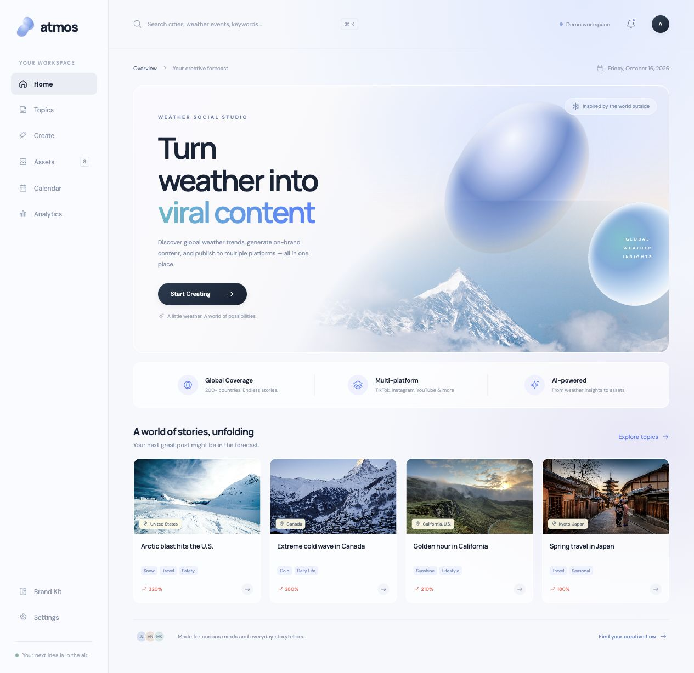

# Atmos — Weather Social Studio

**Turn weather into viral content.**

将天气灵感转化为社媒内容：发现话题、整理简报、编辑脚本与素材，再将内容保存到每周发布日历。

Atmos 是一个英文界面的交互原型，采用冰蓝渐变、玻璃面板与雪景视觉，支持桌面、平板和手机。使用原生 HTML、CSS 和 JavaScript，无需安装依赖或构建。

[在线预览 ↗](https://weather-social-studio-flow.soundsnail12.chatgpt.site/) · [图文使用 Demo](docs/DEMO.md) · [本地运行](#本地运行) · [后端接入方案](BACKEND-PROPOSAL.md)

> 在线预览需要相应的网站访问权限。截图中的内容与数据用于演示；下载源码后可在本地完整体验。



## 从灵感到发布计划

**Discover → Brief → Script → Creative → Calendar**

| 模块 | 可以体验什么 |
| --- | --- |
| **Topic Finder** | 按关键词、地区、时间、天气及内容类型筛选示例热点，查看趋势与受众信息 |
| **Content Brief** | 设置主题、地区、受众和内容角度，选择图文、短视频、轮播等五种格式 |
| **Script Studio** | 选择演示脚本、编辑分镜，并保存自己的版本 |
| **Asset Studio** | 挑选素材、切换比例、编辑标题与文案，预览带分镜字幕的动画 |
| **Publishing Calendar** | 在周日历或按日列表中总览计划，按平台和状态筛选，查看内容、改期与导出 |
| **Review & Export** | 预览社媒卡片、选择平台，导出创作包或保存排期 |
| **Analytics** | 通过周期与维度切换探索示例内容表现 |
| **Workspace** | 素材库、品牌偏好、浏览器草稿保存和 JSON 工作区导出 |

## 界面预览

### 素材创作

选择画面、调整比例和文案，并通过 **Save to Calendar** 将当前创作保存到日历。


### 每周发布日历

按周查看每个平台的内容任务，区分 **Draft** 与 **Scheduled**。每条任务保存独立的简报、脚本、文案、素材引用和排期，继续创作不会覆盖已保存的内容。


<details>
<summary><strong>查看更多：热点筛选与手机排期列表</strong></summary>

#### 热点发现与筛选


#### 手机端列表

手机端可使用 **List** 查看按日期分组的任务；**Week** 支持独立横向滚动。


</details>

所有截图均来自实际运行的页面。日历中的四条示例任务来自本地演示工作区，线上首次打开时不会自动创建。

## 两分钟上手

1. 打开 **Topics**，选择话题，在详情页点击 **Create from this topic**。
2. 填写 **Content Brief**，选择格式，点击 **Generate Scripts**。
3. 选择脚本，通过 **Edit Script** 修改内容，再点击 **Generate Assets**。
4. 选择素材和比例，编辑标题、文案，点击 **Save to Calendar**。
5. 选择日期、时间、平台及 **Draft / Scheduled** 状态，确认保存。
6. 进入左侧 **Calendar** 查看本周计划；点击任务可查看原内容、**Edit Schedule** 改期或 **Export** 导出。

完整步骤与操作截图见 [图文使用 Demo](docs/DEMO.md)。也可以在 Calendar 点击 **New Post**，直接创建计划。

## 本地运行

需要 Git 和 Python 3；仓库访问需要相应的 GitHub 权限。

```bash
git clone https://github.com/MoguCiao/weather-social-studio.git
cd weather-social-studio
python3 -m http.server 4173 --bind 127.0.0.1 --directory dist
```

打开 [http://127.0.0.1:4173](http://127.0.0.1:4173)。已有源码时，进入仓库目录执行最后一行即可；使用 `Ctrl+C` 停止服务。

通过 HTTP 服务访问可让同源图片导出正常工作。图片、字体和脚本均在仓库中，无需第三方 CDN。

## 当前实现范围

| 能力 | 当前状态 |
| --- | --- |
| 页面与交互 | 已实现，可在本地体验完整创作和排期流程 |
| 脚本与素材 | 本地脚本模板和精选摄影素材；未连接真实 AI 生成服务 |
| 天气、热点与分析指标 | 示例数据；未连接实时天气或社交分析 API |
| 日历与草稿 | 保存在当前域名的浏览器 `localStorage`，刷新保留，不跨设备同步 |
| 社交平台发布 | 保存演示排期；未连接 OAuth，也不会触发真实发布 |
| 导出 | 带标题 JPG、原图、TXT 创作包、已保存任务 TXT、工作区 JSON |
| 视频 | 浏览器分镜动画预览；尚不生成 MP4 或音频 |

日历时区为 **Asia / Shanghai**。`Scheduled` 需要未来的日期时间、至少一个平台及文案；未准备好的内容可以先存为 `Draft`。

浏览器数据使用 `atmos-studio-v1` 键。不同域名、浏览器和设备的数据相互独立，清除站点数据也会移除本地草稿；可在 **Settings** 导出工作区 JSON 留存。

## 源码与文档

| 路径 | 内容 |
| --- | --- |
| [`dist/index.html`](dist/index.html) | 页面入口 |
| [`dist/app.js`](dist/app.js) | 路由、工作区状态、示例数据和创作交互 |
| [`dist/styles.css`](dist/styles.css) | 视觉样式与响应式布局 |
| [`dist/calendar.js`](dist/calendar.js) / [`calendar.css`](dist/calendar.css) | 日历、内容快照和任务编辑 |
| [`dist/selects.js`](dist/selects.js) | 自定义筛选菜单与键盘操作 |
| [`dist/assets/`](dist/assets/) | 本地图片、字体与字体许可证 |
| [`docs/DEMO.md`](docs/DEMO.md) | 图文操作演示 |
| [`docs/media/`](docs/media/) | README 和使用演示截图 |
| [`qa/QA.md`](qa/QA.md) | 浏览器验收与功能验证记录 |
| [`BACKEND-PROPOSAL.md`](BACKEND-PROPOSAL.md) | 账户、数据、生成任务与真实发布的接入建议 |
| [`.openai/hosting.json`](.openai/hosting.json) | Sites 静态部署配置，仅发布 `dist/` |

照片来自 Unsplash，字体为 DM Sans 与 Manrope。完整的素材来源和字体许可信息见 [图片与字体来源](docs/ASSETS.md)。
